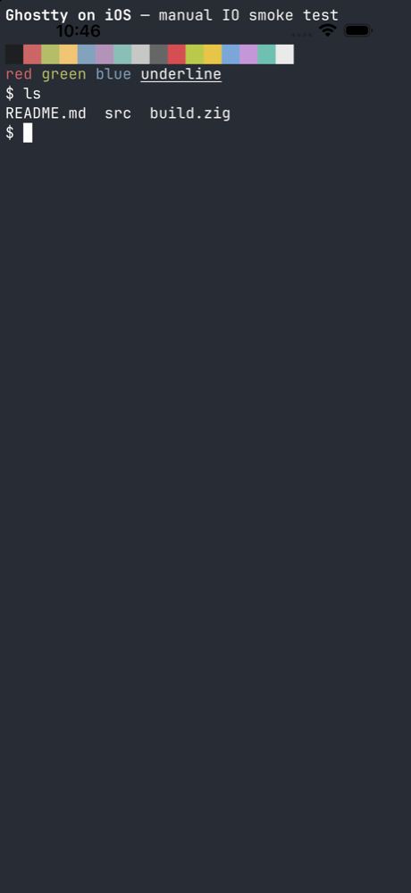

# Ghostty for iOS

An iOS terminal built on libghostty (Ghostty's terminal emulator and Metal
renderer). Version 1 connects to a Mac (or any SSH server) on the local
network.



## Build

Requirements: Xcode 27, [Zig 0.16.0](https://ziglang.org/download/), and
[XcodeGen](https://github.com/yonaskolb/XcodeGen).

```sh
# From the repository root: build GhosttyKit with iOS device and simulator slices.
zig build -Demit-xcframework=true -Demit-macos-app=false -Dxcframework-target=ios

cd ios
cp Config/Local.xcconfig.example Config/Local.xcconfig   # set your team ID and bundle ID
xcodegen generate
open GhosttyiOS.xcodeproj
```

Rebuild the XCFramework whenever the Zig core changes. That build also
installs Ghostty's themes into `zig-out/share/ghostty/themes`; a build phase
copies them into the app as `GhosttyResources/themes`.

## Configuration

Each terminal uses a layered Ghostty config. Later layers win:

1. **App defaults:** `Resources/defaults.ghostty`.
2. **The host's own Ghostty config:** fetched over SSH each time you connect,
   before the shell opens, and cached per host.
   - It reads the standard locations (`~/.config/ghostty/config[.ghostty]` and
     `~/Library/Application Support/com.mitchellh.ghostty/config[.ghostty]`)
     and follows `config-file` includes.
   - Custom themes are fetched too.
   - Options that don't apply on the phone are dropped: `command`,
     `initial-command`, `working-directory`, keybinds, and `macos-*`/`gtk-*`
     window options. Settings → Host configs lists what was dropped.
   - You can turn this off per host.
3. **Settings:** the app's own `~/.config/ghostty/config.ghostty`.
   - Settings has quick controls for common options, an **All options** list
     covering every Ghostty option with its docs, and a raw file editor.
   - Edits are checked with libghostty before they're saved, and they apply to
     open terminals immediately.

Fonts the phone doesn't have (e.g. a Mac-only font) fall back to the built-in
JetBrains Mono.

**Terminal width.** Settings sets how many columns fit across the screen in
portrait (default 80). The font is scaled to fit, and landscape keeps the same
font, so it shows more columns. Pinching a terminal sets a custom width for
that host.

**Option catalog.** `Resources/ConfigCatalog.json` is generated from
Ghostty's docs. To regenerate it:

```sh
zig build -Demit-webdata=true -Demit-xcframework=false -Demit-macos-app=false -Dapp-runtime=none --prefix /tmp/webdata
ghostty +show-config --default > /tmp/defaults.txt
ios/scripts/gen-config-catalog.py /tmp/webdata/share/ghostty/webdata/config.mdx /tmp/defaults.txt > ios/Resources/ConfigCatalog.json
```

## Connect to your Mac

1. On the Mac, turn on **System Settings → General → Sharing → Remote Login**.
2. In the app, tap the key icon and copy this device's public key. Then append
   it to `~/.ssh/authorized_keys` on the Mac, e.g. with Universal Clipboard:
   `pbpaste >> ~/.ssh/authorized_keys`.
3. Add the Mac. It shows up under **On this network** through Bonjour, or you
   can enter its hostname (`Your-Mac.local`) and your username.
4. On the first connection, compare the host key fingerprint with the output
   of `ssh-keygen -lf /etc/ssh/ssh_host_ed25519_key.pub` on the Mac.

If the server refuses the key, the app asks for a password. A password can
also be saved per host in the Keychain.

## Architecture

```
SwiftUI (UI/)  ──►  TerminalSurfaceView (Ghostty/)  ──►  libghostty surface
                         │      ▲                         (manual IO mode)
                 write/resize   │ output
                         ▼      │
                    TerminalBackend (Session/)
                         │
                    SSHBackend (SSH/, Citadel + SwiftNIO SSH)
```

- **Manual IO mode.** iOS can't spawn processes, so this fork adds a `manual`
  termio backend to libghostty (`src/termio/Manual.zig`). The host feeds
  program output with `ghostty_surface_write_output` and receives terminal
  input through `io_write_cb`/`io_resize_cb` on `ghostty_surface_config_s`.
  `ghostty_surface_session_exited` ends the session.
- **`TerminalBackend`** is the seam for future backends. A local on-device
  runtime (so CLI tools and Claude Code can run on the phone) would implement
  the same protocol. No Ghostty or UI changes are needed for that.
- **Keys.** An Ed25519 device key is generated with CryptoKit and stored in
  the Keychain (`AfterFirstUnlockThisDeviceOnly`, not synced).
- **Host keys.** Host keys are trusted on first use after you confirm the
  fingerprint. A changed key fails the connection; you have to forget the
  old key in host settings before connecting again.

## Tests

```sh
cd ios
xcodebuild test -project GhosttyiOS.xcodeproj -scheme GhosttyiOS \
  -destination 'platform=iOS Simulator,name=iPhone 17 Pro'
```

The SSH integration tests run against a real sshd when these variables are
set. A throwaway `sshd -f <config>` running as your user on a high port works:

```sh
TEST_RUNNER_GHOSTTY_TEST_SSH_PORT=2222 \
TEST_RUNNER_GHOSTTY_TEST_SSH_USER=$USER \
TEST_RUNNER_GHOSTTY_TEST_SSH_KEY_SEED=<hex ed25519 seed> \
xcodebuild test ...
```

To also test the config fetch, add `SetEnv XDG_CONFIG_HOME=<fixture>` to that
sshd's config. The fixture's `ghostty/config` should set
`cursor-style = underline` and an `initial-command`, and include
(`config-file = extra.ghostty`) a file that sets
`scrollback-limit-lines = 4242`. Then set
`TEST_RUNNER_GHOSTTY_TEST_SSH_CONFIG_FIXTURE=1`.

`TEST_RUNNER_GHOSTTY_TEST_VISUAL=1` shows sample output full screen for 8
seconds so you can screenshot it. It uses a theme, an 80-column fit, and the
key bar. `TEST_RUNNER_GHOSTTY_TEST_VISUAL_SETTINGS=1` does the same for the
Settings screen.

## Not yet supported

- Local (on-device) shells.
- Files app integration.
- Tabs, splits, or multiple sessions.
- A confirmation UI for OSC 52 clipboard access (these requests are denied).
- Agent forwarding, port forwarding, and jump hosts.
- Reconnecting automatically after the app is suspended.
